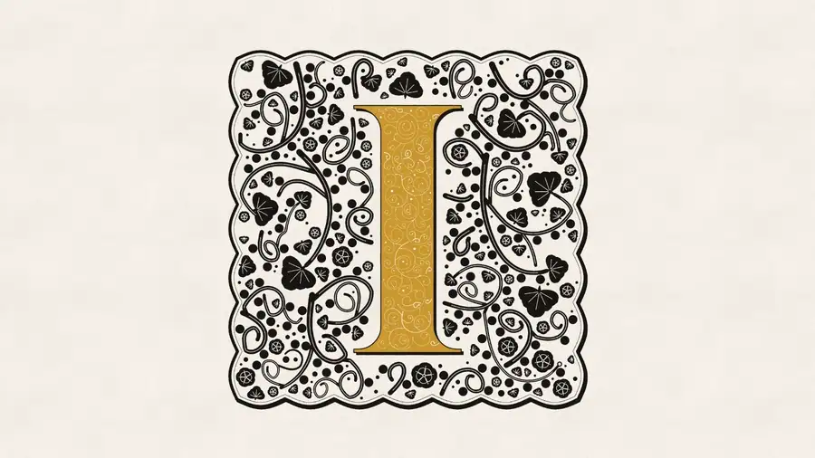

# INITIĀLIS

<a href="https://initialis.azlen.me"></a>

Endless explorer for ornamental drop caps, illuminated lettering, and new typographic aesthetics: https://initialis.azlen.me

Every initial is drawn in your browser: a letter, its frame and ground, an ornament that grows out of it, a texture, and two or three inks printed onto paper. Nothing is a picture made in advance.

- **Drag** to wander. The field fills in as you go.
- **Click** an initial to pick it. **More like this** (or a double-click) fills the field with variations on it: close ones near it, wilder further out.
- **Bookmark** the ones you like; they collect along the bottom. The bookmark at the start of that row opens them all on a page of their own, to **download all** (each on a transparent ground, all of them together on their papers, and their settings) or **share all** as one link.
- **In context** sets it as the opening of a printed page.
- **Share** copies a link that opens on just that initial.
- **Download** gives a zip: the initial on a transparent ground at 2400, 1200, 600 and 256 px, printed on its paper, an animated WebP of it growing in on a transparent ground and an MP4 of it growing in on its paper (when it grows; a GIF in place of the WebP in browsers that can't make WebP), and its settings as JSON.

## Run it yourself

It's a static site with no build step and no dependencies. Serve this folder with anything:

```bash
python3 -m http.server 8000
```

Then open http://localhost:8000. It needs WebGL2 in web workers (any current Chrome, Edge or Firefox, Safari 17 or later). The aged page behind **In context** uses WebGPU and falls back to a flat page without it.

## On your own page

`lib/initialis.js` draws any initial in someone else's page, from a share link or its settings, still or growing in. It works from any site: it brings its own render workers and fetches the fonts from wherever it's served.

```html
<script type="module" src="https://initialis.azlen.me/lib/initialis.js"></script>
<initialis-cap settings='{"text":"Q","font":"cinzel-700","frame":"circle","inkA":"#23305e"}' size="200" grow></initialis-cap>
```

An initial is its settings (what differs from the defaults: a download's `.json` `params`, or a share link with `&format=json`), to keep in the page and change as you like; `src` takes a share link instead. Or from a script: `draw(canvas, P)`, `grow(canvas, P)`, `render(P, { size })` for an ImageBitmap, `settings(link)` and `random(seed)`. 

To wrap text round an initial's own shape, float it as an image with that image as its `shape-outside`:

```html

<p>Your text…</p>
<script type="module">
  import { draw } from 'https://initialis.azlen.me/lib/initialis.js';
  const canvas = document.createElement('canvas');
  await draw(canvas, { text: 'O', font: 'cinzel-700', frame: 'circle' }, { size: 460 });
  const img = document.querySelector('#cap'), url = canvas.toDataURL();
  img.src = url;
  img.style.shapeOutside = `url("${url}")`;
</script>
```

For text outside HTML, or your own line breaking, [Pretext](https://github.com/chenglou/pretext) lays out one line at a time to whatever width each needs.

Every pattern, texture, frame, band, corner, leaf and flower is a small module, fetched only when an initial uses it. To add your own, write one (copy [lib/examples/chevrons.js](lib/examples/chevrons.js); [render/src/kinds/README.md](render/src/kinds/README.md) has each family) and load it with `use(url)`. [lib/check.html](lib/check.html) shows whether a change to the renderer altered anything. [lib/example.html](lib/example.html) shows each, and the head of `lib/initialis.js` lists every option.

## Settings, links and agents

A downloaded initial's `.json` holds:

- `params`: only the settings that differ from the defaults. Every setting, with its range and what it does, is in `PARAMS` in `render/src/params.js`.
- `link`: the site with that initial planted in the middle and variations on it all round. The part after `#` is `seed.q.r.` followed by `params` as URL-safe base64 JSON (`encodeGen` in `src/breed.js`).

A share link is `?i=` with the initial's settings, deflated, after `z.` (`shareCode` in `src/breed.js`); a whole collection is `#c=` the same way, for a list (`collectionCode`). On the site itself links are short instead: `?i=` or `?c=` and a ten-character id, a hash of the settings that the site keeps them under (`shareId`); without the site (offline, or a copy of this one) they're the long kind.

To have an agent use, tweak or make more of an initial, give it this repository and the `.json`. See [AGENTS.md](AGENTS.md).

## What's where

- `src/`: the field: layout, picking, the variations (`breed.js`), the ink that spreads the field in (`inking.js`), downloads, the paper.
- `lib/`: the library, for drawing initials in other pages.
- `render/`: the renderer. The settings (`params.js`), the engine that lays out and paints an initial (`compose.js`), the growing ornament, the ink pass (WebGL2, `ink.js`), all run in workers, and `src/kinds/`: every pattern, texture, frame, band, corner, leaf and flower, a module each.
- `ageing/`: the WebGPU page ageing behind **In context**.

## Licence

The code is MIT ([LICENSE](LICENSE)). The fonts, bundled libraries, hyphenation patterns and texts keep their own terms, listed in [THIRD-PARTY.md](THIRD-PARTY.md).

## Privacy

The site keeps anonymous counts so as to see which patterns and fonts people gravitate toward. No cookies, and nothing about who you are. Browsers that ask not to be tracked aren't counted.

## Fonts

57 faces from Google Fonts under the SIL Open Font License, and four free decorative initial fonts. Only their capitals ship: each face's A to Z outlines as SVG path data in `render/fonts/caps/`, about 1 MB compressed instead of 7 MB of font files, and they draw exactly as the fonts do. Every font and its licence is listed in [render/fonts/FONTS.md](render/fonts/FONTS.md).

The bundled libraries (opentype.js, gifenc, mp4-muxer), the hyphenation patterns and the book texts are credited, with their terms, in [THIRD-PARTY.md](THIRD-PARTY.md).
